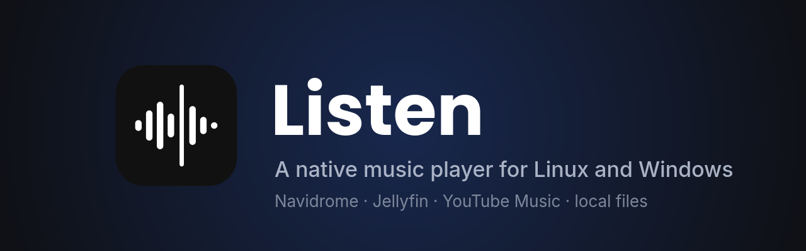
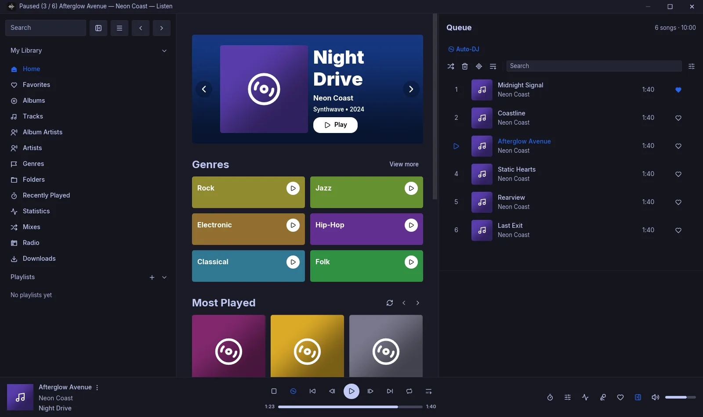
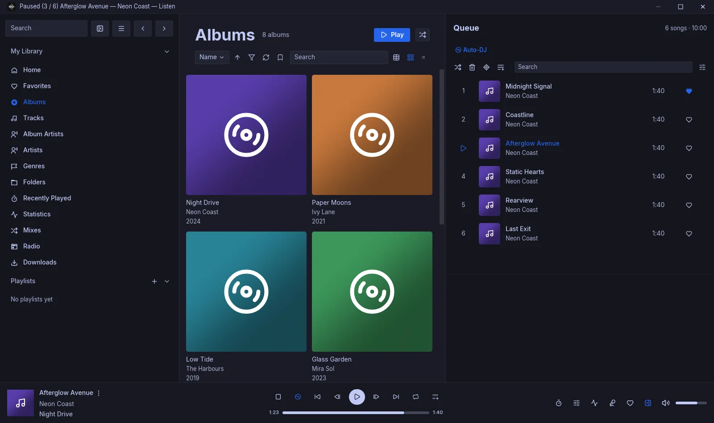
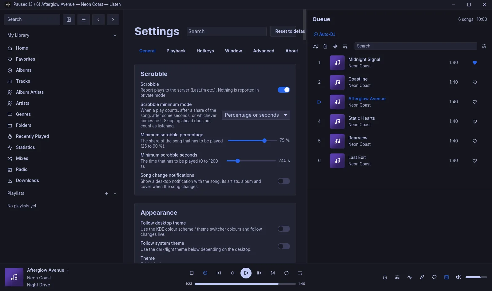
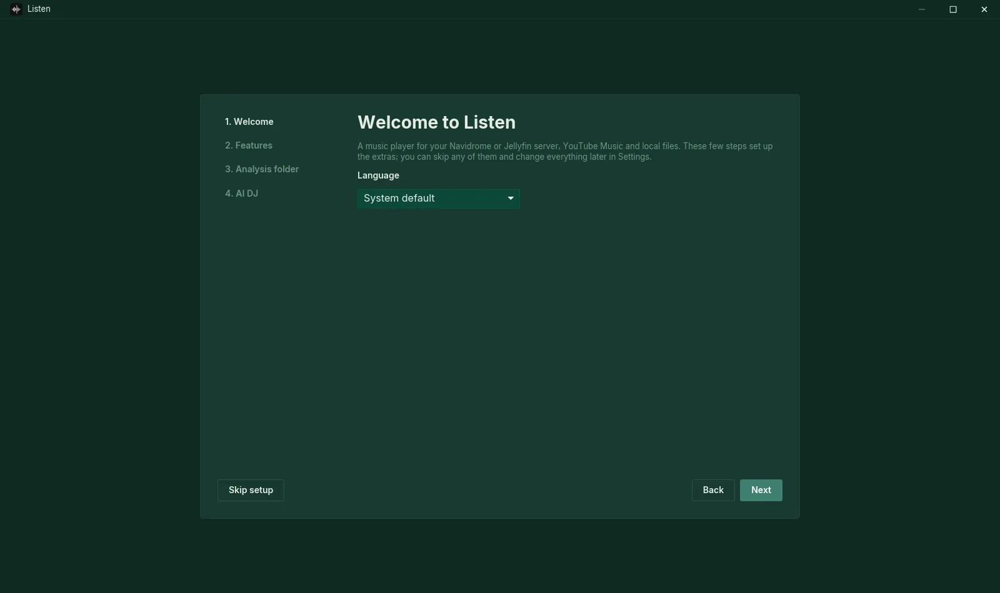
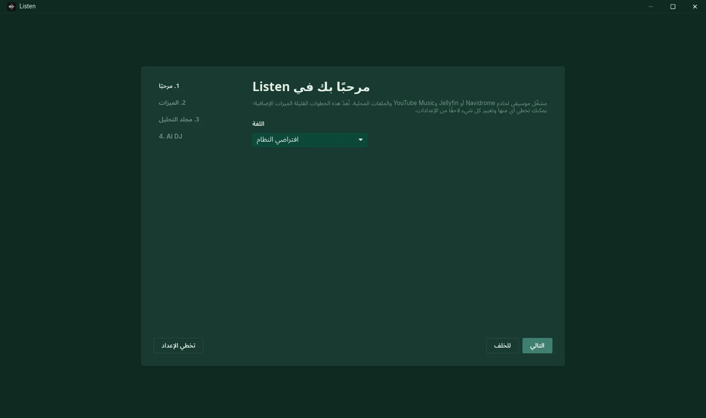

<div align="center">



# Listen

**A fast, native desktop music player for your own music server and YouTube Music.**

Written in Rust. No Electron, no web view: one small program that starts in a blink and stays light on memory.

[**Download**](../../releases/latest) · [**Documentation**](https://leks2205.github.io/Listen/) · [Features](#features) · [Install](#install) · [AI DJ setup](#ai-dj-bring-your-own-gemini-key) · [Report a bug](../../issues/new/choose)


</div>

<p align="center">
  
</p>

---

## Contents

The full user and developer guide is at **[leks2205.github.io/Listen](https://leks2205.github.io/Listen/)**.


- [About](#about)
- [Features](#features)
- [Screenshots](#screenshots)
- [Install](#install)
- [Connecting your music](#connecting-your-music)
- [AI DJ: bring your own Gemini key](#ai-dj-bring-your-own-gemini-key)
- [Updates](#updates)
- [MCP server](#mcp-server-control-listen-from-an-ai-assistant)
- [Privacy](#privacy)
- [Building from source](#building-from-source)
- [Credits](#credits)
- [Legal notes](#legal-notes)
- [License](#license)

## About

Listen plays music from **Navidrome / OpenSubsonic** and **Jellyfin** servers, from **YouTube Music** with your own
account, from **local folders** and from **internet radio**, all in one queue. Its interface follows
[Feishin](https://github.com/jeffvli/feishin) closely, so Feishin users feel at home right away (you can even import
your Feishin settings), but it is a separate program written from scratch in Rust with [iced](https://iced.rs) and
[mpv](https://mpv.io).

On top of a complete player it adds things a music player usually doesn't have: beat-matched **DJ transitions**
between songs, an **AI DJ** that picks sets and talks between them like a radio host, music videos for YouTube Music
songs, automatic **CD ripping**, and **DLNA casting**.

## Features

**Sources**
- Navidrome and other OpenSubsonic servers, Jellyfin (with Quick Connect and LAN discovery), YouTube Music, local
  folders and internet radio. Several servers side by side; one queue can mix them.
- YouTube Music with your own account (unofficial, see [Legal notes](#legal-notes)): library, liked songs,
  playlists (create, edit, reorder), albums, artists, radio, history, music videos, lyrics. Sign-in reads your
  browser's existing YouTube session; no password is typed into Listen.

**Playback**
- mpv engine with gapless playback, ReplayGain, equalizer with presets, compressor, playback speed and pitch, output
  device choice, transcoding and streaming quality per server.
- **Auto-DJ** keeps the queue going with similar songs.
- **DJ transitions**: Listen analyses tempo, beats, key and energy and mixes songs with beat-matched blends, bass
  swaps and filter fades, ordered so neighbours fit. Albums stay gapless. YouTube Music songs can be included once
  you switch that on and choose a folder for the analysis data.
- **AI DJ** (optional, your own Gemini key): picks sets of songs that match the mood and talks between them as a radio
  host, in one of 17 languages, with several personalities and voices.
- Offline downloads from your own server, listening history with statistics and a year review, sleep timer, a compact layout for small windows.

**Interface**
- Pixel-close Feishin layout: home feed, albums, artists, genres, folders, playlists, smart playlists, favorites,
  command palette, full-screen player, Now Playing, queue tools.
- Synced lyrics from several providers, with search, translation, karaoke highlighting and furigana.
- Visualizer (and Milkdrop presets via projectM on Linux).
- 32 built-in themes, custom themes, accent colours, fonts and zoom; on KDE it can follow the desktop's colours.
- 17 UI languages: English, Arabic, Bengali, Chinese (Simplified), Dutch, French, German, Hindi, Italian, Korean,
  Polish, Portuguese, Romanian, Russian, Spanish, Ukrainian and Urdu.

**Desktop integration**
- Media keys and the system media controls (MPRIS on Linux, the media flyout on Windows), global hotkeys, tray icon,
  close to tray, Discord Rich Presence, a remote-control web page for your phone.
- DLNA / UPnP casting to speakers and TVs on your network.
- CD ripping on Linux: insert a disc and Listen rips it securely (whipper, AccurateRip), tags it from MusicBrainz and
  files it into your music folder. See [docs/cd-ripping.md](docs/cd-ripping.md).
- Built-in updater that installs new releases from this repository.
- A built-in MCP server, so AI assistants like Claude can control playback, playlists, the AI DJ and every setting
  (off by default, local only).

## Screenshots

<table>
  <tr>
    <td></td>
    <td></td>
  </tr>
  <tr>
    <td></td>
    <td></td>
  </tr>
</table>

## Install

Download the latest version from the [**Releases**](../../releases/latest) page.

### Windows 10 / 11

1. Download `Listen-Setup-<version>.exe` and run it. It installs for your user only and needs no admin rights.
2. Windows SmartScreen may warn that the app is unrecognised, because the installer isn't code-signed. Click
   **More info → Run anyway**.
3. On first start, the setup wizard offers to install the helper programs Listen plays with: **mpv**, and for
   YouTube Music **yt-dlp** and **Deno**. It runs Windows' package manager `winget` for you (mpv asks for
   administrator rights once). You can also install them yourself:

   ```powershell
   winget install shinchiro.mpv yt-dlp.yt-dlp DenoLand.Deno
   ```

   Update them from **Settings → Advanced → Helper programs** when YouTube Music songs stop playing.

### Fedora

```bash
sudo dnf install ./listen-<version>-1.fc44.x86_64.rpm
```

The RPM pulls in mpv and the other runtime dependencies, and recommends yt-dlp for YouTube Music.

### Other Linux distributions

Unpack `listen-<version>-x86_64.tar.gz` and put the `listen` program on your `PATH`, for example:

```bash
tar xzf listen-<version>-x86_64.tar.gz
install -Dm755 listen-<version>-x86_64/listen ~/.local/bin/listen
install -Dm644 listen-<version>-x86_64/io.github.leks2205.Listen.desktop ~/.local/share/applications/io.github.leks2205.Listen.desktop
install -Dm644 listen-<version>-x86_64/io.github.leks2205.Listen.svg ~/.local/share/icons/hicolor/scalable/apps/io.github.leks2205.Listen.svg
```

You also need **mpv**, and for YouTube Music **yt-dlp** plus **Deno** or **Node.js** (yt-dlp needs a JavaScript
runtime for YouTube). The visualizer uses `pw-record` from PipeWire.

Want to look around first? `listen --demo` starts with a built-in demo library, no server needed.

### First start

A short setup wizard walks you through the language, the features you want (Auto-DJ, DJ transitions, song
analysis, AI DJ, lyrics, Discord status, tray icon, update checks), the folder for analysis data, your Gemini key
for the AI DJ and, on Windows, the helper programs. Every step can be skipped and changed later in Settings.

## Connecting your music

Open **Add server** in the sidebar (or **Settings → General → Servers**).

| Source | What you enter |
|---|---|
| Navidrome / OpenSubsonic | Server address, user name and password |
| Jellyfin | Server address and login, or Quick Connect; servers on your network are found automatically |
| YouTube Music | Pick a browser you're signed in to YouTube with (see below) |
| Local folders | One or more folders with music files |

### YouTube Music

YouTube Music doesn't allow third-party apps to sign in with Google directly, so Listen uses the session of a browser
you already use:

1. Sign in to [music.youtube.com](https://music.youtube.com) in Firefox, Chrome, Edge, Brave, Vivaldi, Chromium or
   Ecosia.
2. In Listen choose **Add server → YouTube Music** and pick that browser. If it's open and locks its cookie file,
   close it completely and try again.
3. If your music lives on a brand channel, pick that channel from the list.

On Windows, recent versions of Chrome, Edge and Brave encrypt their cookies so that no other program can read them.
Use Firefox there, or export the cookies of music.youtube.com with an extension such as *Get cookies.txt LOCALLY* and
choose **Other ways to connect → cookies file**.

Listen only stores *which* browser profile and channel to use. The cookies are read again at each start, stay on
your computer and are only ever sent to YouTube. Without signing in, Listen works as a guest: search, albums, artists,
radio and playback, but no library.

## AI DJ: bring your own Gemini key

The AI DJ uses Google's Gemini API with **your own API key**. Listen ships no key and has no server of its own:
requests go straight from your computer to Google, and the key is kept in your system keyring.

**1. Create a key (free, takes about two minutes)**

1. Open [Google AI Studio → API keys](https://aistudio.google.com/apikey) and sign in with a Google account.
2. Accept the terms if this is your first visit.
3. Click **Create API key**. Pick an existing Google Cloud project or let AI Studio create one for you.
4. Copy the key. It starts with `AIza`. Treat it like a password.

The free tier needs no credit card. Its daily limits are enough for normal listening: Listen asks the text model for
each new set (`gemini-3.5-flash-lite`) and the speech model for each spoken break (`gemini-3.8-flash-lite-tts`, or
`gemini-3.8-flash-tts` for better voice acting). When the daily speech quota runs out, the DJ keeps picking songs
and shows its lines as text instead.

**2. Turn on the AI DJ**

1. In Listen open **Settings → Playback → AI DJ**.
2. Paste the key into **Gemini API key** and press **Save**. Listen checks it right away.
3. Switch **Enabled** on (or tick **Turn on the AI DJ** in the setup wizard), then pick a **Persona**, the **Language** the hosts speak and, if you like, a
   **Location** and **Details for the DJ** (your name, what you like, topics to avoid).
4. Start any song and choose **AI DJ** with the play-mode button in the player bar.

**Good to know**

- Listen sends Google the songs it chooses from (title, artist, year, genre, and tempo, key and energy where
  analysed), what just played or was skipped, the DJ's previous line, and your settings for the show (persona,
  language, location, pronunciation and *Details for the DJ*). Nothing else leaves your computer. Outside the EU, UK and Switzerland, Google may use free-tier requests to
  improve its products; paid usage (billing enabled on the key's project) is not used that way. If you enable
  billing, set a budget alert in Google Cloud.
- You can remove the key at any time: clear the field and press **Save**. You can also delete or restrict the key in
  AI Studio.
- Keep your key to yourself. Anyone with it can use your quota.

## Updates

Listen checks this repository's releases (Settings → Advanced → Updates; on by default at start-up) and asks before
installing anything. Downloads are checked against the release's `SHA256SUMS`. Depending on how you installed it,
the update replaces the RPM, the program in `~/.local/bin`, or runs the new Windows installer.

## MCP server (control Listen from an AI assistant)

Listen has a built-in [Model Context Protocol](https://modelcontextprotocol.io) server, so an AI assistant such as
Claude can play music, manage the queue and playlists, change the AI DJ and adjust any setting for you. It runs inside
Listen on your own computer; nothing is hosted anywhere else.

**Turn it on:** **Settings → Window → MCP server → Enable MCP server**. Listen then listens on
`http://127.0.0.1:4334/mcp` (Streamable HTTP) and creates an access token, which it keeps in your keyring.

**Connect a client:**

- **Claude Code:** press **Copy command** in the same section and run it, or type:

  ```bash
  claude mcp add --transport http listen http://127.0.0.1:4334/mcp --header "Authorization: Bearer <token>"
  ```

- **Claude Desktop and other clients:** add a remote/HTTP MCP server with the URL `http://127.0.0.1:4334/mcp` and the
  header `Authorization: Bearer <token>` (**Copy token** puts the token on the clipboard). Clients that only speak
  stdio can use a bridge such as `npx mcp-remote http://127.0.0.1:4334/mcp --header "Authorization: Bearer <token>"`.

**What it can do**

| Area | Tools |
|---|---|
| Playback | `get_now_playing`, `play`, `pause`, `toggle_play`, `next`, `previous`, `seek`, `set_volume`, `set_play_mode`, `set_repeat`, `set_speed`, `sleep_timer` |
| Queue | `get_queue`, `play_songs`, `add_to_queue`, `play_queue_entry`, `remove_from_queue`, `move_in_queue`, `shuffle_queue`, `clear_queue` |
| Library | `list_servers`, `switch_server`, `search`, `get_album`, `get_artist`, `list_playlists`, `get_playlist`, `start_radio`, `get_lyrics` |
| Playlists | `create_playlist`, `add_to_playlist`, `remove_from_playlist`, `rename_playlist`, `delete_playlist` |
| Favorites | `set_favorite`, `set_rating` |
| AI DJ | `get_ai_dj`, `list_personas`, `set_ai_dj` (persona, voice model, language, location, details, set size, voice level), `set_gemini_key` |
| Settings | `get_settings`, `set_settings` (any setting, as a partial JSON object; invalid values are refused and listed), `get_analysis_status` |

**Security**

- Only programs on this computer can connect, unless you switch on **Allow other computers**. Every request needs
  the token; **New token** disconnects every client.
- Whatever has the token can control Listen fully: change settings, edit or delete playlists on your servers, and
  use your Gemini quota through the AI DJ. Treat the token like a password.
- No tool ever returns passwords, cookies, API keys or the token itself.

## Privacy

- No telemetry, no analytics, no account with us. Listen talks only to the servers and services you set up and the
  ones listed in **Settings → About**.
- Passwords, tokens and API keys are kept in the system keyring (Secret Service on Linux, Credential Manager on
  Windows) or, when there is none, in a credentials file inside Listen's config folder that only your user can read.
- Logs and the diagnostics export remove passwords, cookies, tokens and credentials in URLs.
- Listening history stays on your computer.

## Building from source

You need a recent stable Rust toolchain (`rustup`), mpv, and on Linux the usual Wayland/X11 development headers.

```bash
git clone https://github.com/leks2205/Listen.git
cd Listen
cargo run --release -p listen -- --demo        # demo library, no server needed
cargo test --workspace                           # tests (some need mpv)
```

Windows builds are cross-compiled from Linux with MinGW (`rustup target add x86_64-pc-windows-gnu`, then
`cargo build --release --target x86_64-pc-windows-gnu -p listen`). `packaging/windows/build-installer.sh` builds the
installer and `packaging/build-rpm.sh` the RPM and tarball.

**Project layout**

| Path | What's in it |
|---|---|
| `app/` | The iced application: state, pages, settings, platform integration |
| `crates/listen-core` | Library model, queue, settings (incl. the Feishin importer), themes |
| `crates/listen-source` | The `MusicSource` trait each backend implements |
| `crates/listen-subsonic`, `listen-jellyfin`, `listen-ytmusic`, `listen-local` | The music sources |
| `crates/listen-player` | mpv control (two decks for gapless play and mixing) |
| `crates/listen-analysis`, `listen-mix` | Audio analysis and the DJ transition engine |
| `crates/listen-dj` | The AI DJ (Gemini text and speech) |
| `crates/listen-lyrics`, `listen-visualizer`, `listen-dlna`, `listen-offline`, `listen-rip` | Lyrics, visualizer, casting, downloads, CD ripping |
| `docs/` | Notes on themes, YouTube Music, DJ transitions and CD ripping |

Bug reports and pull requests are welcome. Please run `cargo fmt`, `cargo clippy --workspace --all-targets` and the
tests before opening a pull request.

## Credits

Listen's design is modelled closely on **[Feishin](https://github.com/jeffvli/feishin)** by jeffvli and its
contributors: the layout, the player, the settings and many details follow Feishin, and Listen's themes and UI
translations are derived from Feishin's. If you like how Listen looks, that's their work. Please go and star Feishin.

Listen is built on [mpv](https://mpv.io), [yt-dlp](https://github.com/yt-dlp/yt-dlp),
[iced](https://iced.rs), [ytmapi-rs](https://github.com/nick42d/youtui),
[Beat This!](https://github.com/CPJKU/beat_this), [bliss](https://github.com/Polochon-street/bliss-rs),
[projectM](https://github.com/projectM-visualizer/projectm), [whipper](https://github.com/whipper-team/whipper) and
many other open-source crates. Lyrics come from [LRCLIB](https://lrclib.net) and other providers, release data from
[MusicBrainz](https://musicbrainz.org) and the [Cover Art Archive](https://coverartarchive.org). Fonts: Inter and
Poppins (SIL Open Font License). Icons: [Lucide](https://lucide.dev), [Remix Icon](https://remixicon.com) and
[Simple Icons](https://simpleicons.org). The full list, with links, is in **Settings → About**.

## Legal notes

- **Unofficial.** Listen is an independent project. It is not affiliated with, endorsed or sponsored by Google
  LLC, YouTube, Navidrome, Jellyfin or Feishin. YouTube and YouTube Music are trademarks of Google LLC.
- **YouTube Music support is unofficial.** It uses YouTube Music's web interface and the separately installed
  [yt-dlp](https://github.com/yt-dlp/yt-dlp), may stop working whenever YouTube changes something, and may not be
  allowed by [YouTube's Terms of Service](https://www.youtube.com/t/terms). You use it with your own account and at
  your own risk; YouTube may restrict accounts it considers to be accessed by unofficial clients. A YouTube Music
  Premium subscription is recommended. Listen does not download YouTube Music songs for offline use.
- **No content is provided by Listen.** It plays what your own servers, files and accounts give you access to.
- **AI DJ.** Requests go from your computer to Google under your own key and Google's
  [Gemini API terms](https://ai.google.dev/gemini-api/terms) (which require you to be 18 or older). Outside the EU,
  UK and Switzerland, Google may use free-tier requests to improve its products, and human reviewers may read them.
- **Windows security warnings.** The installer isn't code-signed yet, and reading a browser's YouTube sign-in looks
  unusual to some antivirus programs. Listen only reads the cookies of youtube.com and music.youtube.com, only when
  you pick a browser, and never sends them anywhere but YouTube.

## License

Listen is free software: you can redistribute it and/or modify it under the terms of the
[GNU Affero General Public License v3.0](LICENSE) or (at your option) any later version.

Parts are derived from Feishin and stay under the GNU General Public License v3.0; fonts, icons and the Rust crates
Listen is built from keep their own licenses. See [NOTICE.md](NOTICE.md) and the `THIRD_PARTY_LICENSES.html` that
ships with every release.

The name "Listen" and the app icon are not covered by the license. If you publish a modified version, please give
it a different name and icon.
